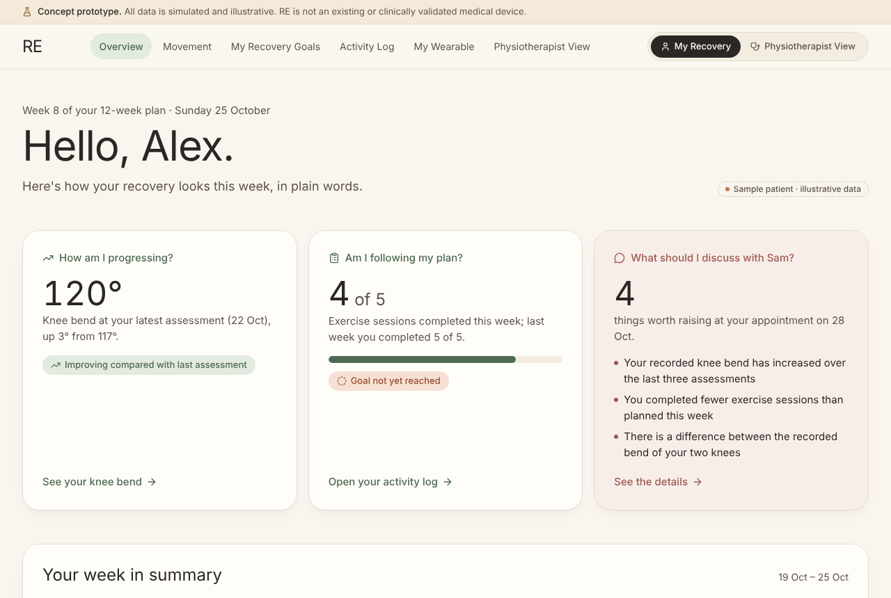
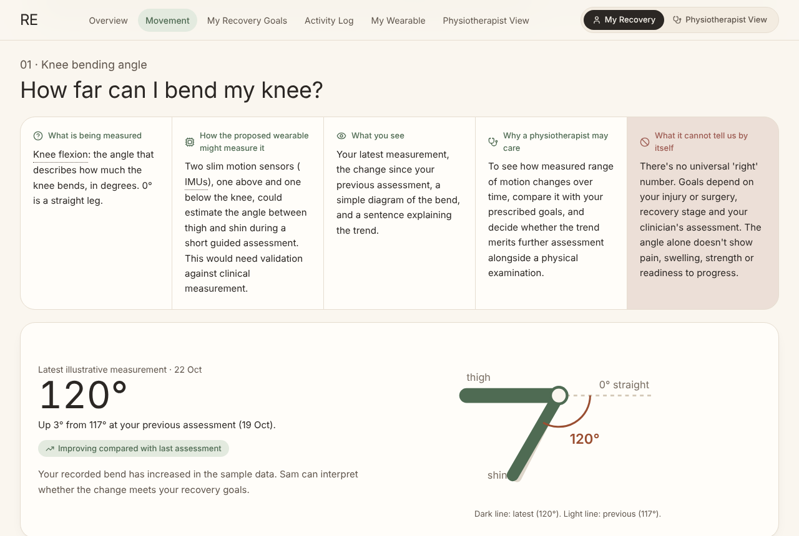
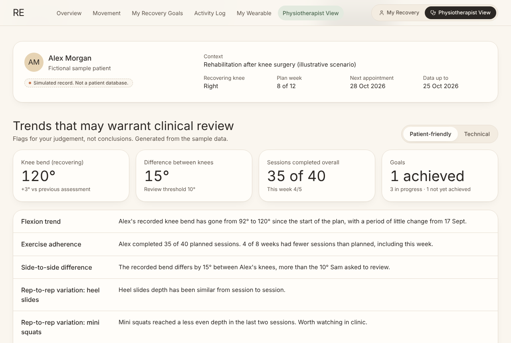
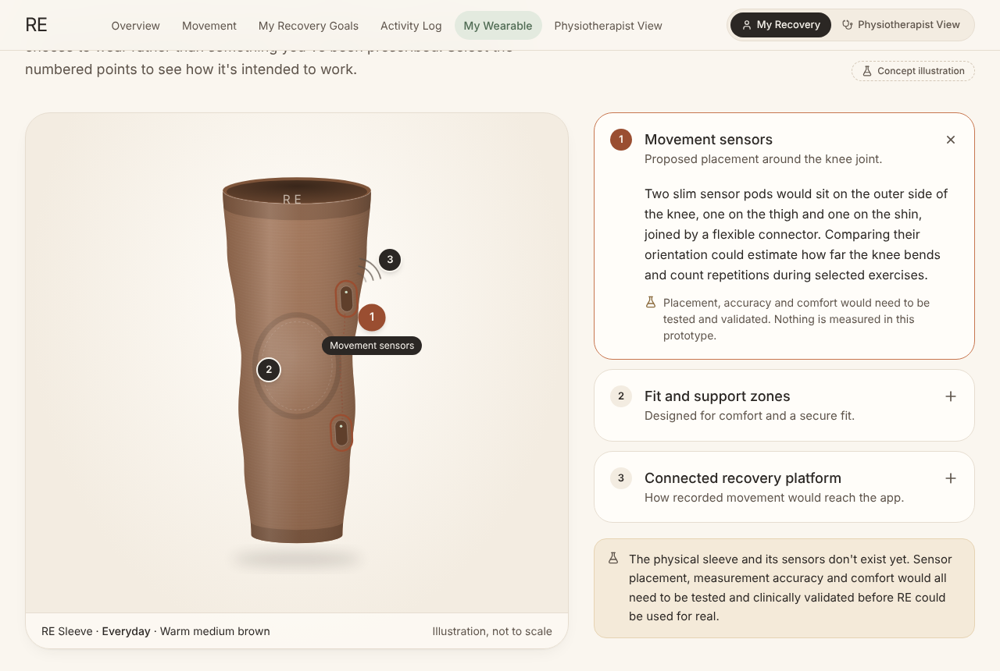
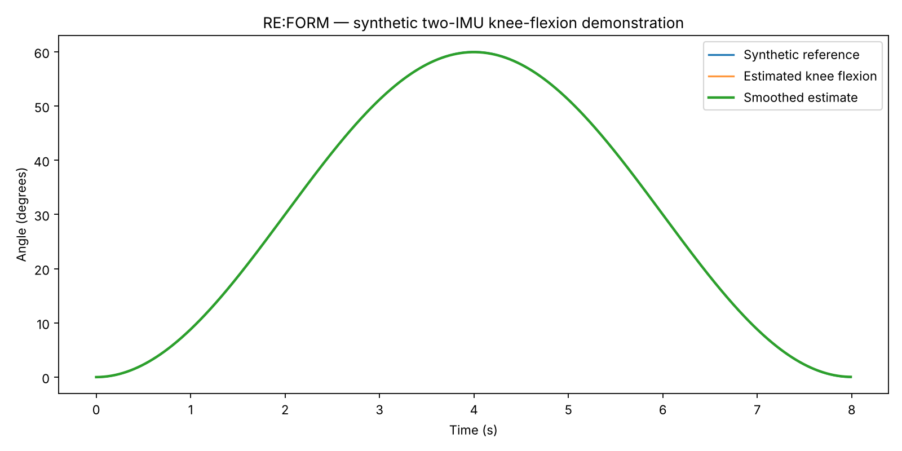

# RE: Recovery, in motion.

**RE** (also called **RE:FORM** in the research notes) is an early-stage concept for a smart knee support and recovery platform. It is designed for people recovering from knee injuries or surgery, and for the physiotherapists who support them.

This repository holds two connected prototypes:

1. **A web app** showing how patients and physiotherapists could review recovery progress.
2. **A Python experiment** exploring how two motion sensors could estimate knee bend.

> **Concept prototype.** The wearable and its sensors don't exist yet. All data in this repository is simulated and illustrative. RE is not a clinically validated or approved medical device and is not intended for diagnosis or treatment.



## What's in this repository

| Folder | What it is | Start here |
|---|---|---|
| [`web-app/`](web-app/) | The interactive prototype: a patient experience and a physiotherapist view, built with Next.js, React and TypeScript | [Web app README](web-app/README.md) |
| [`research/movement-sensing/`](research/movement-sensing/) | Python experiments estimating knee flexion from a thigh sensor and a shin sensor, using synthetic data | [Research README](research/movement-sensing/README.md) |
| [`docs/`](docs/) | A project walkthrough and screenshots | [Project walkthrough](docs/project-walkthrough.md) |

## Quick start

### Web app

You need [Node.js](https://nodejs.org) 20.9 or newer.

```bash
cd web-app
```

```bash
npm install
```

```bash
npm run dev
```

Then open **http://localhost:3000**. The command keeps running while you use the app; press Ctrl+C to stop it.

### Movement-sensing experiment

You need Python 3.10 or newer.

```bash
cd research/movement-sensing
```

```bash
pip install -r requirements.txt
```

```bash
python run_all.py
```

It prints error metrics and saves a plot to `research/movement-sensing/outputs/`. The [research README](research/movement-sensing/README.md) shows how to do this in a virtual environment.

## A closer look

| | |
|---|---|
|  |  |
| **Movement, made meaningful.** Each metric explains what it measures, how it might be measured, and what it can't tell you. | **Physiotherapist View.** The same data with more detail, flags for clinical review and a sample report. |
|  |  |
| **My Wearable.** The proposed sleeve, with clickable annotations and colour and style options. | **Research.** Knee flexion estimated from two simulated sensors, compared with the known angle. |

## How the two parts connect

```
Thigh + shin sensors  →  signal processing  →  validated measurements  →  patient & physiotherapist app
   (not built yet)       (research/ explores     (future work)              (web-app/ demonstrates
                          this on synthetic                                  with simulated data)
                          data)
```

None of these steps are connected end to end yet.

## Project status

| Area | Status |
|---|---|
| Web app interface, navigation, charts, filters, customiser, sample report | Working prototype |
| Patient, physiotherapist, measurements and goals in the app | Simulated sample data |
| Two-sensor knee-angle estimation | Educational experiment on synthetic data |
| Physical wearable, sensor hardware, Bluetooth sync | Not built |
| Measurement accuracy and clinical validation | Not done; required before any real-world use |

The [project walkthrough](docs/project-walkthrough.md) lists the next engineering milestones.

## Repository layout

```
.
├── README.md                    You are here
├── docs/
│   ├── project-walkthrough.md   How the project was built and how the parts fit together
│   └── screenshots/             Images used in these READMEs
├── web-app/                     Next.js prototype (see web-app/README.md)
│   ├── src/                     App code: views, charts, sample data, logic
│   ├── scripts/                 Single-file shareable build
│   └── package.json
└── research/
    └── movement-sensing/        Python two-IMU experiment (see its README)
        ├── reform_sensing.py
        ├── run_all.py
        ├── experiments.md
        ├── data/
        └── outputs/
```
