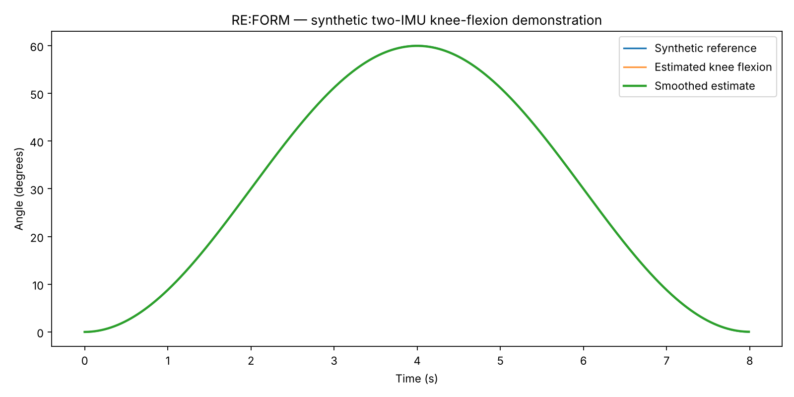

# Movement-sensing experiments (RE:FORM)

[← Back to the project overview](../../README.md)

An early, educational Python prototype exploring how two motion sensors (inertial measurement units, or **IMUs**), one on the thigh and one on the shin, could be used to estimate how far the knee bends (**knee flexion**).

> **Synthetic data only.** Every signal here is generated by code. This is not a validated measurement system or a medical device, and its outputs must not be used for diagnosis, treatment or return-to-sport decisions.

## What it does

```
synthetic thigh + shin IMU signals
        │
        ▼
estimate each segment's tilt (pitch)      accelerometer angle + gyroscope rate,
        │                                 combined with a complementary filter
        ▼
knee flexion = shin pitch − thigh pitch
        │
        ▼
smooth, then compare with the known synthetic angle (MAE, RMSE, bias)
```

The four experiments, and a fifth planned one with real sensors, are described step by step in [`experiments.md`](experiments.md).

## Example result



The three lines overlap almost exactly because the synthetic signals are idealised: gravity only, perfectly aligned sensors, no noise. The errors in [`outputs/synthetic_metrics.json`](outputs/synthetic_metrics.json) (about 0.02–0.03°) only show that the code behaves as expected under those assumptions. They are **not** evidence of accuracy on real people or hardware.

## Run it

Requirements: Python 3.10 or newer.

```bash
cd research/movement-sensing
```

```bash
python -m venv .venv
```

Activate the environment. On macOS or Linux:

```bash
source .venv/bin/activate
```

On Windows:

```bash
.venv\Scripts\activate
```

Then install the dependencies and run the pipeline:

```bash
pip install -r requirements.txt
```

```bash
python run_all.py
```

The script prints the error metrics and writes these files to `outputs/`:

| File | Contents |
|---|---|
| `knee_angle_estimate.png` | Plot of the reference, estimated and smoothed knee angle |
| `synthetic_metrics.json` | MAE, RMSE and bias, in degrees |
| `estimated_signals.csv` | Every input channel plus the intermediate and final estimates (regenerated each run, not committed) |

Running the script also regenerates `data/synthetic_two_imu_data.csv`. The regenerated file has more decimal places and tiny differences in the gyroscope columns compared with the committed copy, so restore it with `git checkout -- data/` if you don't want that change.

## Files

| Path | Purpose |
|---|---|
| [`reform_sensing.py`](reform_sensing.py) | Core functions: synthetic data, accelerometer pitch, complementary filter, smoothing, relative angle, error metrics, CSV loader |
| [`run_all.py`](run_all.py) | Runs the full demonstration and saves the outputs |
| [`experiments.md`](experiments.md) | Each experiment's inputs, process, outputs and why it matters, plus known limitations |
| [`requirements.txt`](requirements.txt) | Python dependencies (numpy, pandas, matplotlib) |
| [`data/`](data/) | Synthetic two-IMU input data |
| [`outputs/`](outputs/) | Example plot and metrics from a run |

### Using your own recordings

`load_imu_csv()` in `reform_sensing.py` reads a CSV with these columns, and `add_estimates()` then produces the knee-angle estimate:

`time_s`, `thigh_ax`, `thigh_ay`, `thigh_az`, `thigh_gx`, `thigh_gy`, `thigh_gz`, `shin_ax`, `shin_ay`, `shin_az`, `shin_gx`, `shin_gy`, `shin_gz`

`summarize_estimate()` also needs a `reference_knee_deg` column measured by a reference method.

## Limitations

- Planar (sagittal-plane) movement only, with assumed sensor axes.
- No anatomical calibration of sensor-to-body alignment.
- A gravity-only accelerometer model: real movement accelerations would disturb the tilt estimate.
- No full 3D orientation fusion or magnetometer, and no realistic soft-tissue movement or gyroscope drift.

Physical sensors, calibration, synchronisation and comparison against a reference measurement (Experiment 5) would all be needed before interpreting any result.
